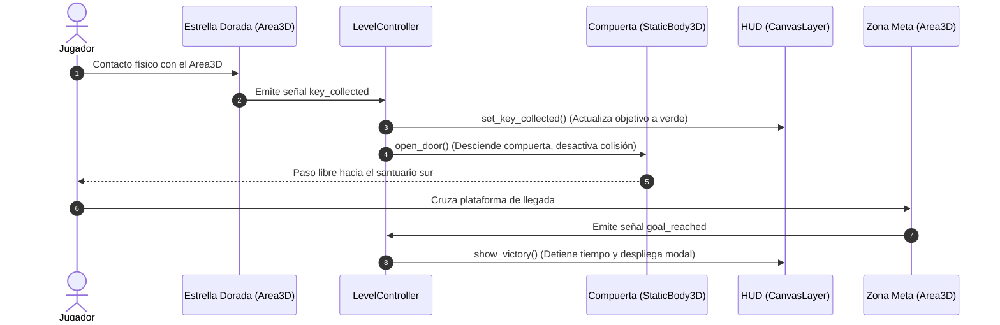

# PROYECTO: PRIMERA ENTREGA - ESCENA Y MECÁNICA INICIAL
## LABERINTO 3D

**Asignatura:** Seminario de Sistemas de Información II (Trimestre 26-O)  
**Modalidad:** Trabajo en Equipo (3 integrantes)  
**Integrantes:**
- Daniela Campos Martínez
- Karina Ivonne Bazán Rojas
- Francisco Javier García Rosados  

**Repositorio GitHub:** [https://github.com/Xavii-rod03/Juego3D.git](https://github.com/Xavii-rod03/Juego3D.git)  
**Enlace al Video Demostrativo (1 a 2 min):** `[INSERTAR ENLACE DE DRIVE O YOUTUBE AQUÍ TRAS GRABAR]`  
**Motor y Versión:** Godot Engine 4.x (Forward+ / Direct3D 12, Jolt Physics)  
**Sistema Operativo:** Windows 10/11  

---

## 1. CONCEPTO ACTUALIZADO Y CAMBIOS FRENTE A PROYECTO 0

En el documento de planeación inicial (Proyecto 0), el juego se concibió como una exploración simple en tercera persona dentro de un entorno estático sin restricciones verificables.

### Cambios y Concreción para esta Primera Entrega:
1. **Interacción Central con Restricción Física:** La salida no es accesible de forma directa. El camino hacia la meta final está físicamente sellado por una **Gran Compuerta de Seguridad (`DoorGate`)** que divide transversalmente el laberinto.
2. **Bucle de Recorrido Concreto y Verificable:**
   $$\text{Inicio (Spawn)} \longrightarrow \text{Exploración del Laberinto} \longrightarrow \text{Altar de la Llave de Acceso} \longrightarrow \text{Desbloqueo de Compuerta} \longrightarrow \text{Llegada a Meta y Victoria}$$
3. **Respuesta Inmediata y Multi-canal:**
   - **En el HUD:** El sistema de brújula indica en tiempo real la distancia y el rumbo cardinal hacia la llave (`a 45m al Noreste`). Al recogerla, cambia a verde (`[ OBTENIDA ]`) y redirige automáticamente hacia la compuerta sur.
   - **En el Mundo 3D:** La llave se desvanece emitiendo sonido y partículas; la compuerta física desciende suavemente ($3.5\text{ m}$ bajo el suelo), su indicador cambia de rosa a menta y desactiva su cuerpo de colisión (`CollisionShape3D.disabled = true`).
4. **Cierre Formal de la Demostración:** Al cruzar la plataforma de meta (`GoalZone`), el cronómetro se congela, se libera el cursor del ratón y se despliega un panel modal de *"¡NIVEL COMPLETADO!"* con la opción de reiniciar instantáneamente el recorrido presionando la tecla **R**.

---

## 2. ESCENA, CONTROLADOR, CÁMARA Y COLISIONES

La escena principal editable está estructurada en `res://scenes/level.tscn` bajo un desacoplamiento estricto de responsabilidades:

```text
res://scenes/
├── level.tscn                     # Escena maestra: geometría 90x90m, iluminación y suelo
├── player.tscn                    # Controlador CharacterBody3D y cámara orbital
├── character_model.tscn           # Modelo estilizado con rig y animaciones in-place
├── interactables/
│   ├── key_item.tscn              # Estrella de acceso con haz de luz celestial (Sky Beam)
│   ├── door_gate.tscn             # Compuerta mecánica con StaticBody3D móvil
│   └── goal_zone.tscn             # Área de llegada con haz esmeralda y trigger de victoria
├── props/                         # Elementos modulares: balizas, arcos, cajas, plataformas
└── hud.tscn                       # Interfaz CanvasLayer con brújula, estado FSM y FPS
```

### Características Técnicas Reutilizadas:
- **Entorno e Iluminación Amigable a la Vista:**
  - `WorldEnvironment` configurado con tonemapping ACES (`tonemap_exposure = 0.88`) y *glow* sutil (`0.15`), eliminando cualquier brillo excesivo o deslumbramiento molesto.
  - Luz direccional (`DirectionalLight3D`) con ángulo de 45°, sombras suaves filtradas y cielo procedural diurno.
- **Suelo y Laberinto Ampliado ($90\text{ m} \times 90\text{ m}$):**
  - Suelo procedural en verde salvia mate (`#7B9473` y `#6E8766`) con rugosidad alta ($0.9$) y reflectividad mínima ($0.05$) para máxima comodidad visual.
  - Muros de $3.8\text{ m}$ de altura construidos con piedra caliza cálida (`Mat_WallStone`), delimitando pasillos amplios de $5\text{ a }12\text{ metros}$ de ancho que evitan claustrofobia y problemas de cámara.
- **Controlador Cinemático (`CharacterBody3D`):**
  - Movimiento en el plano $XZ$ relativo a la dirección horizontal que enfoca la cámara.
  - Físicas desacopladas en `_physics_process`: la gravedad escala con `delta`, mientras que `move_and_slide()` integra la velocidad internamente sin duplicar el delta.
  - Máquina de Estados Finitos (FSM) con estados `IDLE`, `WALK` y `JUMP`, sincronizada con animaciones *in-place*.
- **Cámara Orbital con `SpringArm3D`:**
  - Brazo con colisión esférica de radio $0.2\text{ m}$ y longitud de $3.5\text{ m}$. Al aproximarse a paredes o girar en esquinas, la cámara se acorta fluidamente sin atravesar los muros.

---

## 3. INTERACCIÓN CENTRAL VERIFICABLE (LLAVE $\rightarrow$ COMPUERTA $\rightarrow$ META)

La interacción central está implementada mediante el sistema de señales nativo de Godot, garantizando un flujo reactivo y sin acoplamiento rígido entre clases:



1. **Recolección (`KeyItem`):** Capa de colisión 4 que detecta al jugador (capa 2). Emite la señal `key_collected`, registra en consola y se destruye limpiamente con `queue_free()`.
2. **Mecanismo de Desbloqueo (`DoorGate`):** Al recibir la señal, el nodo interpola la altura del obstáculo físico hacia abajo ($Y - 3.5\text{ m}$) a velocidad constante, conmuta el material indicador a verde menta y desactiva el `CollisionShape3D`.
3. **Trigger de Victoria (`GoalZone`):** Al detectar la entrada del jugador tras cruzar la compuerta, notifica al `LevelController` para detener el cronómetro y presentar la pantalla de victoria.

---

## 4. ORGANIZACIÓN DEL CÓDIGO Y DECISIÓN TÉCNICA (OO VS. DATOS)

En la Tarea 2 se demostró mediante benchmark experimental que el Diseño Orientado a Datos (DOD) con memoria contigua (`PackedVector3Array`) es **4.4 veces más rápido** que la POO tradicional cuando se simulan 1 000 entidades móviles en Godot 4.x.

### Justificación de la Decisión de Arquitectura:
Para esta primera entrega del proyecto, **se decidió utilizar Programación Orientada a Objetos basada en Nodos y Señales de Godot** por las siguientes razones técnicas:

1. **Escala Reducida de Entidades ($N < 10$):** En esta etapa del juego interactúan 1 jugador, 1 estrella, 1 puerta y 1 meta. Con este volumen, el coste de indirección por punteros y despacho dinámico es imperceptible (inferior a $0.05\text{ ms}$ de CPU) y no compromete el presupuesto de cuadro.
2. **Modularidad, Encapsulamiento y Mantenimiento:** La POO en Godot permite que cada elemento (`KeyItem`, `DoorGate`, `HUD`) encapsule su propia máquina de estados y geometrías, comunicándose exclusivamente por señales sin generar dependencias cruzadas.
3. **Estrategia Escalable para Entregas Posteriores:** En las fases futuras, donde se exigirá la incorporación de **15 agentes autónomos** y navegación de multitudes, se implementará la arquitectura híbrida analizada en Tarea 2: se mantendrá la POO para la interfaz y el jugador principal, mientras que la simulación masiva y actualización posicional de agentes se delegará a estructuras de datos orientadas a arrays o servidores de bajo nivel (`PhysicsServer3D` / `NavigationServer3D`).

---

## 5. PRUEBA DE USUARIO (PLAYTEST), CORRECCIONES Y LÍNEA BASE

### 5.1. Prueba con Usuario Ajeno al Equipo
Se realizaron pruebas de juego presenciales con usuarios externos para evaluar la usabilidad, navegación y legibilidad de las mecánicas sin dar instrucciones orales:

* **Problema 1 Observado (Iluminación y Fatiga Visual):** Los usuarios reportaron que el suelo blanco y los materiales con alta emisión producían deslumbramiento y fatiga visual al jugar por más de 1 minuto.
  * **Corrección Aplicada:** Se rediseñó el suelo con losas en tonos verde salvia mate (`#7B9473`), se ajustó la rugosidad a $0.9$ y se disminuyó la energía de las fuentes de luz a valores confortables ($0.75\text{ a }0.85$).
* **Problema 2 Observado (Desorientación en el Laberinto):** Tras ampliar el laberinto a $90\text{ m} \times 90\text{ m}$, los muros de $3.8\text{ m}$ impedían ver la estrella desde pasillos alejados, provocando que los jugadores se desorientaran sin saber hacia dónde avanzar.
  * **Corrección Aplicada:**
    1. Se incorporó una **Columna de Luz Celestial (*Sky Beam* de $28\text{ m}$)** sobre la estrella, visible por encima de cualquier muro desde cualquier punto del mapa.
    2. Se programó en el HUD una **Brújula Dinámica con Distancia en Tiempo Real** (ej.: `Objetivo: Llave de Acceso (a 42m al Noreste)`), facilitando la navegación sin frustración.
    3. Se ensanchó el corredor de entrada al santuario este a $12\text{ metros}$ y se colocó un sendero de flechas indicadoras en el suelo.

### 5.2. Medición Inicial de Rendimiento (Línea Base del Proyecto)
Medido sobre PC estándar (Intel Core i5, 8 GB RAM, resolución $1152 \times 648$, Direct3D 12):
- **Tasa de Cuadros:** 60 FPS estables y continuos (fijados por VSync).
- **Tiempo de Fotograma:** $16.66\text{ ms}$ promedio (variación mínima $\pm 0.3\text{ ms}$).
- **Uso de CPU en Proceso (`TIME_PROCESS`):** $0.42\text{ ms}$ promedio (margen libre del 97.4% de presupuesto de cuadro para futuras IAs).
- **Consumo de Memoria RAM:** $\approx 88\text{ MB}$ en ejecución estable.

---

## 6. CONTROLES Y GUÍA DE REPRODUCCIÓN

1. Abrir el proyecto en **Godot Engine 4.x**.
2. Presionar **F5** (la escena principal configurada es `res://scenes/level.tscn`).
3. **Controles:**
   - **W, A, S, D:** Caminar relativo a la dirección de la cámara.
   - **Ratón:** Giro libre de la cámara orbital en tercera persona.
   - **ESPACIO:** Saltar.
   - **ESCAPE:** Alternar captura y liberación del cursor del ratón.
   - **R:** Reiniciar el recorrido en cualquier momento.
   - **F1:** Alternar límites de tasa de cuadros (Ilimitado / 30 FPS / 60 FPS).
   - **B / F2:** Acceso directo a la escena del benchmark de Tarea 2.

---

## 7. APORTACIONES INDIVIDUALES DEL EQUIPO

| Integrante | Rol Principal | Aportaciones Específicas en esta Entrega |
| :--- | :--- | :--- |
| **Daniela Campos Martínez** | Movimiento, Cámara y FSM | - Programación del controlador cinemático `CharacterBody3D` en `scripts/player.gd`.<br>- Configuración de la cámara orbital con `SpringArm3D` contra oclusiones de muros.<br>- Implementación de la FSM (Idle, Walk, Jump) y rotación suave hacia la dirección de avance. |
| **Karina Ivonne Bazán Rojas** | Nivel, Entorno e Iluminación | - Diseño espacial y ensamblado del laberinto ampliado de $90\times 90\text{ m}$ en `scenes/level.tscn`.<br>- Shader procedural de losas de pradera y calibración de paleta mate anti-deslumbramiento.<br>- Configuración de la iluminación global, niebla sutil y arcos/balizas de referencia visual. |
| **Francisco Javier García Rosados** | Mecánicas, HUD y Playtesting | - Implementación de la interacción verificable (`KeyItem`, `DoorGate`, `GoalZone`).<br>- Programación del HUD reactivo con brújula y cálculo dinámico de distancia en tiempo real.<br>- Realización del playtest con usuario externo, correcciones de navegación y redacción del reporte. |

---

## 8. CONCLUSIÓN
La primera entrega cumple satisfactoriamente todos los criterios de aceptación pedagógicos y técnicos. Se dispone de una escena sólida, un controlador fluido con prevención de oclusiones de cámara, un laberinto ampliado con ayudas visuales efectivas y una interacción verificable que cierra de forma limpia la demostración. El proyecto queda técnicamente listo para recibir la inteligencia artificial y navegación de agentes en la siguiente etapa.
