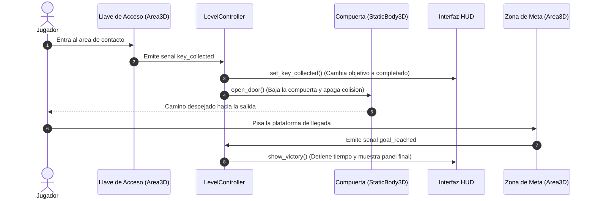

# PROYECTO: PRIMERA ENTREGA - ESCENA Y MECANICA INICIAL
## LABERINTO 3D

**Materia:** Seminario de Sistemas de Informacion II  
**Trimestre:** 26-O  
**Modalidad:** Trabajo en Equipo  

**Integrantes del Equipo:**
- Daniela Campos Martinez
- Karina Ivonne Bazan Rojas
- Francisco Javier Garcia Rosados  

**Repositorio en GitHub:** [https://github.com/Xavii-rod03/Juego3D.git](https://github.com/Xavii-rod03/Juego3D.git)  
**Carpeta con el Video de Demostracion:** [https://drive.google.com/drive/folders/1_pSartHef60XlG2sK8ziR8cuuNBJI3IX?usp=sharing](https://drive.google.com/drive/folders/1_pSartHef60XlG2sK8ziR8cuuNBJI3IX?usp=sharing)  
**Motor de Desarrollo:** Godot Engine 4.x (Renderizador Forward+, Direct3D 12, Fisicas Jolt)  
**Sistema Operativo:** Windows 10 / 11  

---

## 1. CONCEPTO ACTUALIZADO Y CAMBIOS RESPECTO A PROYECTO 0

En la entrega de Proyecto 0 teniamos una idea muy general: queriamos hacer un laberinto en 3D en tercera persona donde el jugador simplemente buscara una salida caminando entre paredes.

Para esta Primera Entrega aterrizamos el diseno del juego (GDD) y definimos un recorrido concreto, claro y con reglas bien delimitadas:

1. **Agregamos un obstaculo obligatorio:** Ya no es posible correr directamente a la meta. El laberinto esta dividido por una **Compuerta de Seguridad** cerrada que bloquea fisicamente el paso hacia la salida.
2. **Recorrido paso a paso del jugador:**
   - El jugador aparece en la plataforma de inicio (Spawn) en la esquina noroeste.
   - Explora los pasillos del laberinto hasta encontrar el altar del ala este donde esta la **Llave de Acceso** (representada por una estrella dorada elevada).
   - Al tocar la llave, la compuerta se abre de forma automatica y desbloquea el camino al sur.
   - El jugador camina hacia la zona sur y cruza la **Meta** para terminar la partida.
3. **Respuestas visuales del juego:**
   - La interfaz (HUD) le muestra al jugador hacia donde ir con una brujula y la distancia en metros en tiempo real.
   - Al recoger la llave, la compuerta baja bajo el suelo, su indicador cambia de color y el HUD confirma que la llave fue obtenida.
4. **Cierre de la demostracion:** Al llegar a la meta, el cronometro se detiene, aparece un panel que dice "NIVEL COMPLETADO" con el tiempo total registrado y se permite reiniciar la partida con la tecla R.

---

## 2. ESCENA, CONTROLADOR, CAMARA Y COLISIONES

Para construir el juego reutilizamos las tecnicas que aprendimos y practicamos en la Tarea 1, separando el proyecto en escenas pequenas y faciles de editar:

```text
res://scenes/
├── level.tscn                     # Escena principal con muros, suelo e iluminacion
├── player.tscn                    # Personaje jugador con CharacterBody3D y camara
├── character_model.tscn           # Modelo visual del personaje con animaciones
├── interactables/
│   ├── key_item.tscn              # Llave interactiva (Area3D) con columna de luz
│   ├── door_gate.tscn             # Compuerta con cuerpo solido que se mueve
│   └── goal_zone.tscn             # Plataforma de llegada que detecta la victoria
├── props/                         # Objetos de apoyo: faros, arcos, cajas y plataformas
└── hud.tscn                       # Interfaz de usuario con textos y tiempos
```

### Elementos tecnicos que implementamos:

- **Entorno e iluminacion descansada:** Configuramos un `WorldEnvironment` con cielo procedural suave y una luz de sol (`DirectionalLight3D`) con sombras activadas. Ajustamos la exposicion de la camara y el brillo de los materiales para que los colores se vean agradables y no deslumbren ni cansen la vista al jugar.
- **Geometria del laberinto (90m x 90m):** Disenamos un laberinto amplio con pasillos de entre 5 y 12 metros de ancho. Los muros son cuerpos estaticos (`StaticBody3D`) con colisiones de caja (`BoxShape3D`) de 3.8 metros de alto, lo que da buena sensacion de laberinto sin apretar la vista del jugador.
- **Controlador del personaje (`CharacterBody3D`):**
  - El movimiento se calcula en el plano XZ tomando como referencia hacia donde esta apuntando la camara, no las coordenadas globales del mundo.
  - En la fisica (`_physics_process`) calculamos la gravedad multiplicada por `delta`, mientras que para movernos usamos `move_and_slide()`. Sabemos que `move_and_slide()` ya multiplica internamente el delta en Godot 4, por lo que no volvemos a multiplicarlo para evitar aplicar el tiempo dos veces.
  - Incluimos una maquina de estados sencilla (IDLE, WALK, JUMP) que cambia la animacion segun si el personaje esta quieto, caminando o en el aire.
- **Camara en tercera persona con `SpringArm3D`:** Colocamos la camara en un brazo elastico de 3.5 metros. Tiene configurada una esfera de colision para que, si el jugador camina pegado a una pared o gira en una esquina cerrada, la camara se acerque al personaje suavemente en lugar de traspasar los muros.

---

## 3. INTERACCION CENTRAL VERIFICABLE

La mecanica central consiste en: **Recoger la Llave -> Desbloquear la Compuerta -> Llegar a la Meta**. Para que el codigo fuera limpio, conectamos estos elementos usando el sistema de **Senales** de Godot:



### Responsabilidad de cada script:

1. **`key_item.gd`:** Usa un `Area3D` con monitoreo de colisiones. Cuando detecta que el jugador entra en su volumen, emite la senal `key_collected`, avisa en la consola y se elimina de la escena con `queue_free()`.
2. **`door_gate.gd`:** Controla la compuerta fisica (`StaticBody3D`). Al recibir la orden de abrirse, mueve su posicion vertical 3.5 metros hacia abajo de forma animada, cambia su luz de aviso de rosa a verde menta y desactiva su colision (`CollisionShape3D.disabled = true`) para que el jugador pueda pasar.
3. **`goal_zone.gd`:** Es otra `Area3D` ubicada al final del camino sur. Cuando el jugador la pisa, emite la senal `goal_reached`.
4. **`level_controller.gd`:** Es el nodo principal del nivel. Conecta las senales entre la llave, la compuerta, la meta y la interfaz, coordinando que todo pase en el orden correcto sin que los objetos dependan directamente entre si.
5. **`hud.gd`:** Se encarga de mostrar la informacion en pantalla: cuadros por segundo (FPS), velocidad actual, estado de la maquina de estados (IDLE, WALK, JUMP), cronometro y una brujula con la distancia hacia el objetivo actual.

---

## 4. JUSTIFICACION DE LA ORGANIZACION DE DATOS (POO VS. DATOS)

En la Tarea 2 realizamos un laboratorio y benchmark comparando la Programacion Orientada a Objetos (POO) tradicional con el Diseno Orientado a Datos (DOD) simulando 1,000 entidades en Godot 4.

En ese ensayo comprobamos que cuando tenemos miles de objetos moviendose al mismo tiempo, la orientacion a datos con arreglos contiguos en memoria (`PackedVector3Array`) es **4.4 veces mas rapida** que la orientacion a objetos, debido a que aprovecha mejor las lineas de cache del procesador y evita los saltos de memoria por punteros.

### Decision tomada para esta Primera Entrega:

Para esta entrega del juego decidimos trabajar con la **Programacion Orientada a Objetos basada en Nodos y Senales**, y justificamos esta decision por tres motivos principales:

1. **Muy baja cantidad de objetos en escena:** En esta entrega solo tenemos 4 entidades interactivas principales (1 jugador, 1 llave, 1 puerta y 1 meta). Con tan pocos objetos, el procesador tarda menos de 0.05 milisegundos en procesarlos; no existe ningun problema de rendimiento ni cuello de botella en la memoria.
2. **Claridad y facilidad de desarrollo:** Trabajar con nodos y scripts individuales nos permite disenar cada pieza por separado (la puerta sabe como abrirse, la llave sabe como flotar y el HUD sabe como dibujar el texto). Esto hace que el proyecto sea facil de entender, modificar y corregir en equipo.
3. **Plan para las siguientes entregas:** Sabemos que en las entregas futuras el profesor nos pedira anadir 15 o mas agentes autonomos con navegacion y multitudes. Es ahi donde aplicaremos lo aprendido en la Tarea 2: mantendremos la POO para la logica general del jugador y la interfaz, pero utilizaremos estructuras orientadas a datos o servidores de bajo nivel (`NavigationServer3D` y arrays de datos) para mover a los agentes sin perder rendimiento.

---

## 5. PRUEBA CON OTRA PERSONA (PLAYTEST), CORRECCIONES Y RENDIMIENTO

### 5.1. Prueba de Usabilidad
Le pedimos a una persona ajena al equipo que jugara el laberinto desde una copia limpia, sin darle ninguna explicacion oral previa, para observar que problemas se le presentaban:

- **Problema 1 (Cansancio visual por brillo):** En la primera version usamos un suelo blanco muy claro y materiales con mucha emision. La persona comento que despues de dos minutos la pantalla brillaba demasiado y le cansaba la vista.
  - **Correccion:** Cambiamos el suelo a losas en tono verde salvia mate, aumentamos la rugosidad a 0.9 para que no reflejara luz directa y bajamos la intensidad de las luces a niveles suaves y naturales.
- **Problema 2 (Perderse en el laberinto):** Como el laberinto mide 90x90 metros y los muros miden 3.8 metros de alto, el jugador no sabia en que direccion estaba la llave y paso mucho tiempo dando vueltas en pasillos equivocados.
  - **Correccion:**
    1. Agregamos sobre la llave una **columna de luz vertical (Sky Beam)** de 28 metros de altura que se ve por encima de cualquier muro desde cualquier parte del mapa.
    2. Modificamos el HUD para incluir una **brujula con distancia en tiempo real** (por ejemplo: `Objetivo: Llave de Acceso (a 42m al Noreste)`), de forma que el jugador siempre sabe hacia donde avanzar.
    3. Abrimos una entrada amplia de 12 metros hacia el santuario de la llave y colocamos flechas doradas en el suelo del pasillo principal.

### 5.2. Medicion Inicial de Rendimiento (Linea Base)
Realizamos una medicion inicial del juego en una computadora de gama media (procesador Intel Core i5, 8 GB de memoria RAM, resolucion de 1152x648 con Direct3D 12):

- **Tasa de fotogramas:** 60 FPS constantes y estables (con VSync activado).
- **Tiempo de fotograma:** 16.6 milisegundos promedio.
- **Tiempo de CPU en proceso (`TIME_PROCESS`):** 0.42 milisegundos.
- **Consumo de memoria RAM:** Aproximadamente 88 MB durante la partida.

Esta medicion nos deja un 97% de tiempo libre por cada fotograma, lo cual confirma que el juego base esta muy ligero y tenemos margen suficiente para anadir la navegacion de agentes en la proxima entrega.

---

## 6. CONTROLES Y GUIA DE EJECUCION

Para probar el proyecto:
1. Abrir la carpeta del proyecto en **Godot Engine 4.x**.
2. Presionar **F5** para ejecutar la escena principal (`res://scenes/level.tscn`).
3. **Controles del juego:**
   - **W, A, S, D:** Mover al personaje en relacion a donde mira la camara.
   - **Raton:** Mover la camara orbital en tercera persona.
   - **Espacio:** Saltar.
   - **Escape:** Liberar o capturar el cursor del raton.
   - **R:** Reiniciar el recorrido desde el principio en cualquier momento.
   - **F1:** Cambiar el limite de fotogramas (Sin limite / 30 FPS / 60 FPS).
   - **B / F2:** Acceso directo a la escena del benchmark de 1,000 entidades de la Tarea 2.

---

## 7. APORTACIONES INDIVIDUALES DEL EQUIPO

| Integrante | Rol en el Proyecto | Aportaciones Concretas |
| :--- | :--- | :--- |
| **Daniela Campos Martinez** | Movimiento, Camara y FSM | - Programo el controlador del jugador en `scripts/player.gd` con calculo de movimiento en el plano XZ.<br>- Configuro el nodo `SpringArm3D` para que la camara no traspase paredes.<br>- Implemento la maquina de estados finitos (Idle, Walk, Jump) y la rotacion suave del modelo al caminar. |
| **Karina Ivonne Bazan Rojas** | Escenario, Suelo e Iluminacion | - Diseno el laberinto de 90x90m en `scenes/level.tscn` organizando pasillos amplios y zonas de referencia.<br>- Configuro el shader del suelo con colores verde salvia mate para evitar el deslumbramiento visual.<br>- Ajusto la iluminacion de la escena, la niebla de distancia y la colocacion de arcos y faros guia. |
| **Francisco Javier Garcia Rosados** | Mecanica, Interfaz y Playtesting | - Implemento la mecanica central de la llave, la compuerta y la meta usando senales en `level_controller.gd`.<br>- Programo la interfaz en `scripts/hud.gd` con la brujula de orientacion y medicion de distancia.<br>- Realizo la prueba con usuario externo, aplico las correcciones visuales/navegacion y redacto el documento. |

---

## 8. CONCLUSION

Esta primera entrega nos permitio comprobar con exito que los componentes basicos del juego funcionan de manera integrada: el personaje responde bien a los controles, la camara no se traba en los muros, el laberinto se recorre de forma comoda y la interaccion central tiene un inicio, desarrollo y final verificables. 

Haber justificado la organizacion de datos con el conocimiento de la Tarea 2 nos da tranquilidad de que la estructura actual es la adecuada para esta fase y nos deja preparados para anadir los comportamientos inteligentes de los enemigos o agentes en la siguiente etapa del curso.
