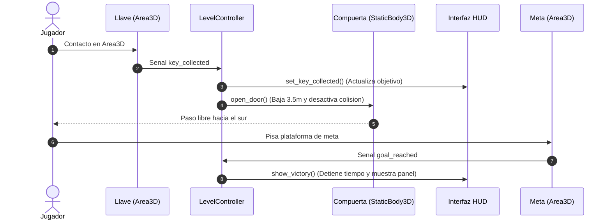

# PROYECTO: PRIMERA ENTREGA - ESCENA Y MECANICA INICIAL
## LABERINTO 3D

**Materia:** Seminario de Sistemas de Informacion II (Trimestre 26-O)  
**Modalidad:** Trabajo en Equipo  

**Integrantes del Equipo:**
- Daniela Campos Martinez
- Karina Ivonne Bazan Rojas
- Francisco Javier Garcia Rosados  

**Repositorio GitHub:** [https://github.com/Xavii-rod03/Juego3D.git](https://github.com/Xavii-rod03/Juego3D.git)  
**Carpeta del Video:** [https://drive.google.com/drive/folders/1_pSartHef60XlG2sK8ziR8cuuNBJI3IX?usp=sharing](https://drive.google.com/drive/folders/1_pSartHef60XlG2sK8ziR8cuuNBJI3IX?usp=sharing)  
**Motor y Entorno:** Godot Engine 4.x (Forward+, Direct3D 12, Fisicas Jolt) sobre Windows 10 / 11  

---

## 1. CONCEPTO ACTUALIZADO Y CAMBIOS FRENTE A PROYECTO 0

En Proyecto 0 propusimos una exploracion simple en un laberinto estatico sin objetivos claros. Para esta Primera Entrega concretamos la dinamica de juego:

1. **Restriccion y objetivo:** El paso a la salida esta bloqueado fisicamente por una **Compuerta de Seguridad**. El jugador debe explorar el laberinto, recoger la **Llave de Acceso** para abrirla y luego cruzar la **Meta**.
2. **Recorrido del jugador:**
   - Aparece en la plataforma de inicio (Spawn) al noroeste.
   - Sigue los pasillos guiado por la brujula del HUD y una columna de luz vertical visible sobre los muros.
   - Llega al altar este, toma la llave y el sistema notifica en pantalla la apertura de la compuerta.
   - Cruza la compuerta abierta en el sector sur y pisa la plataforma de meta.
3. **Cierre de la partida:** Al llegar a la meta, el cronometro se detiene y se muestra la pantalla de nivel completado con el tiempo registrado y la tecla R para reiniciar.

---

## 2. ESCENA, CONTROLADOR, CAMARA Y COLISIONES

Reutilizamos lo aprendido en la Tarea 1 organizando el nivel en escenas modulares en `res://scenes/`:

```text
res://scenes/
├── level.tscn           # Escena principal (laberinto de 90x90m, iluminacion y suelo)
├── player.tscn          # Jugador (CharacterBody3D) con camara orbital SpringArm3D
├── character_model.tscn # Modelo 3D y animaciones (idle, walk, jump)
├── hud.tscn             # Interfaz (tiempo, velocidad, brujula y estado FSM)
├── interactables/       # Objetos interactivos (key_item.tscn, door_gate.tscn, goal_zone.tscn)
└── props/               # Decoracion funcional (balizas de luz, arcos, cajas, plataformas)
```

### Componentes tecnicos implementados:
- **Entorno e iluminacion:** Configuramos luz direccional (`DirectionalLight3D`) con sombras suaves y cielo procedural. Para evitar cansancio visual, usamos un suelo de losas en verde salvia mate con baja reflectividad especular.
- **Muros y colisiones:** Muros de 3.8m con `StaticBody3D` y colisiones `BoxShape3D`, delimitando pasillos amplios de 5 a 12 metros de ancho.
- **Controlador (`CharacterBody3D`):** Movimiento calculado en el plano XZ segun hacia donde mira la camara. La gravedad escala con `delta` en `_physics_process` y el desplazamiento se realiza con `move_and_slide()` sin duplicar el delta. Cuenta con maquina de estados (IDLE, WALK, JUMP).
- **Camara orbital con `SpringArm3D`:** Brazo con colision de 3.5m que se encoge de forma fluida al rozar muros para impedir que la camara atraviese las paredes.

---

## 3. INTERACCION CENTRAL VERIFICABLE

La mecanica central conecta los objetos mediante el sistema de senales de Godot:



### Responsabilidad de los scripts:
- **`key_item.gd`:** Detecta al jugador, emite `key_collected` y se destruye con `queue_free()`.
- **`door_gate.gd`:** Baja la compuerta 3.5m, cambia su luz indicadora a verde y apaga su colision (`CollisionShape3D.disabled = true`).
- **`goal_zone.gd`:** Detecta la llegada del jugador y emite `goal_reached`.
- **`level_controller.gd`:** Conecta las senales de la llave, compuerta y meta con la interfaz.
- **`hud.gd`:** Muestra FPS, cronometro, estado de movimiento y la brujula con distancia en tiempo real.

---

## 4. JUSTIFICACION DE ORGANIZACION DE DATOS (POO VS. DATOS)

En la Tarea 2 comprobamos mediante benchmark que el Diseno Orientado a Datos (DOD) con memoria contigua (`PackedVector3Array`) es 4.4 veces mas rapido que la POO al procesar 1,000 entidades, gracias al mejor aprovechamiento de la memoria cache.

### Justificacion para esta entrega:
Para la Entrega 1 decidimos usar **Programacion Orientada a Objetos (POO)** basada en nodos y senales por dos razones:

1. **Escala minima:** Solo tenemos 4 entidades interactivas (jugador, llave, compuerta y meta). El tiempo de proceso de CPU es insignificante ($< 0.05\text{ ms}$), por lo que la POO no afecta el rendimiento.
2. **Claridad modular:** La POO permite encapsular cada componente por separado, facilitando el desarrollo y mantenimiento en equipo.

Para las siguientes entregas, cuando se incorporen los 15 agentes autonomos y multitudes, aplicaremos una estructura hibrida: POO para el jugador y la interfaz, y orientacion a datos o servidores de bajo nivel para la navegacion masiva de agentes.

---

## 5. PRUEBA CON OTRA PERSONA (PLAYTEST) Y RENDIMIENTO

### 5.1. Prueba de juego
Se probo el juego con un usuario externo sin darle instrucciones orales:

- **Problema 1 (Cansancio visual):** El suelo blanco original brillaba demasiado tras jugar un par de minutos.  
  *Solucion:* Cambiamos el suelo a losas verde salvia mate (rugosidad 0.9) y redujimos la intensidad de las luces a valores suaves.
- **Problema 2 (Desorientacion):** Los muros de 3.8m tapaban la llave en el laberinto de 90x90m.  
  *Solucion:* Agregamos una columna de luz vertical (Sky Beam de 28m) visible desde cualquier pasillo, colocamos flechas en el suelo y anadimos una brujula con distancia dinamica en el HUD (ej. `Objetivo: Llave de Acceso (a 35m al Noreste)`).

### 5.2. Medicion inicial de rendimiento (Linea base)
Medido en PC de gama media (Intel Core i5, 8 GB RAM, resolucion 1152x648 con Direct3D 12):
- **Tasa de fotogramas:** 60 FPS estables (VSync).
- **Tiempo de fotograma:** 16.6 ms promedio.
- **Uso de CPU (`TIME_PROCESS`):** 0.42 ms (dejando 97% del presupuesto libre para futuras IAs).
- **Memoria RAM:** 88 MB en ejecucion.

---

## 6. CONTROLES Y GUIA DE EJECUCION

1. Abrir el proyecto en **Godot Engine 4.x** y presionar **F5** (`res://scenes/level.tscn`).
2. **Controles:**
   - **W, A, S, D:** Moverse segun la vista de la camara.
   - **Raton:** Girar la camara orbital en tercera persona.
   - **Espacio:** Saltar.
   - **Escape:** Liberar o capturar el cursor del raton.
   - **R:** Reiniciar el recorrido desde el inicio.
   - **F1:** Alternar limite de fotogramas (Sin limite / 30 FPS / 60 FPS).

---

## 7. APORTACIONES INDIVIDUALES DEL EQUIPO

| Integrante | Rol | Aportaciones Concretas |
| :--- | :--- | :--- |
| **Daniela Campos Martinez** | Movimiento, Camara y FSM | Controlador `CharacterBody3D`, camara con `SpringArm3D` contra muros y maquina de estados finitos (Idle, Walk, Jump). |
| **Karina Ivonne Bazan Rojas** | Escenario, Suelo e Iluminacion | Diseno del laberinto de 90x90m en `scenes/level.tscn`, shader de suelo verde mate anti-deslumbramiento y calibracion de luces y arcos. |
| **Francisco Javier Garcia Rosados** | Mecanica, Interfaz y Playtesting | Interaccion llave-compuerta-meta mediante senales en `level_controller.gd`, brujula en `scripts/hud.gd`, playtest y reporte tecnico. |

---

## 8. CONCLUSION

La primera entrega cumple con todos los objetivos planteados: el personaje responde correctamente a los controles, la camara no atraviesa muros, el recorrido es fluido y la mecanica central cuenta con retroalimentacion inmediata y cierre verificable. La base queda lista para integrar la navegacion inteligente de agentes en la siguiente etapa.
